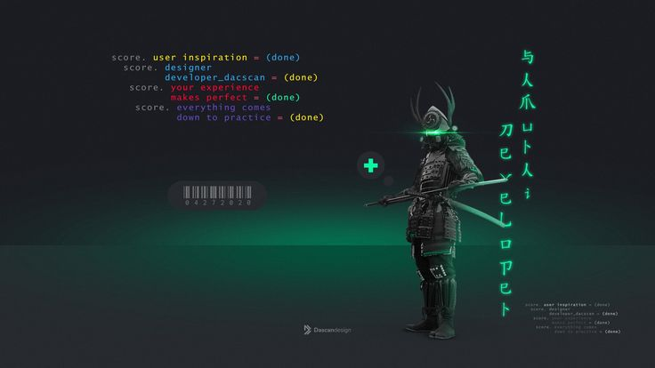

  

  <h1>Hi, I'm Abdulhakeem 👋</h1>
  
<strong>Computer Science undergraduate · Aspiring Software Engineer</strong>

  
I enjoy building practical web experiences, learning how systems work, and improving through hands-on projects.

  

    <a href="https://bigmuak-portfolio-site.vercel.app/">Portfolio</a> ·
    <a href="https://www.linkedin.com/">LinkedIn</a>
  

---

## About Me

- 🎓 Studying Computer Science at the University of Ilorin.
- 🛠️ Building **Uni-Marketplace**, an ongoing marketplace project.
- 🌱 Currently strengthening my software engineering fundamentals and full-stack development skills.
- 🤝 Open to learning, collaboration, and student internship opportunities.

## Tech I Work With

  
  
  
  
  
  
  
  

## Featured Projects

### Uni-Marketplace
An ongoing marketplace project focused on helping university students discover products from student sellers. I'm building it while learning to design, implement, and maintain a real application.

### Personal Portfolio
A personal website showcasing my background, skills, and projects.

### StatusKit
A project I've contributed to. I'll add a more detailed description once I've documented the specific contribution.

## GitHub Activity

  
  

  

---

  <i>Learning by building. Getting better one project at a time.</i>

