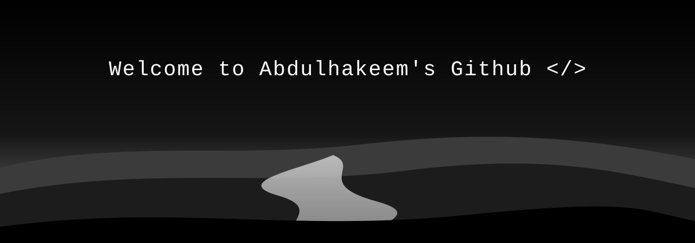

  

  
  

<h2 align="center">👤 About me</h2>

Hello There! I'm <b><i>Abdulhakeem</i></b>, a Computer Science undergraduate and aspiring software engineer. I enjoy building practical web experiences, learning how systems work, and improving through hands-on projects.

  <b>🎓 Studying Computer Science at the University of Ilorin</b> 
  <b>🛠️ Building Uni-Marketplace, an ongoing marketplace project</b> 
  <b>🌱 Strengthening software engineering and full-stack fundamentals</b> 
  <b>🤝 Open to learning, collaboration, and student internships</b>

<h2 align="center">⚙️ Technologies</h2>

  
  
  
  
  
  
  
  

<h2 align="center">📈 Statistics</h2>

    
  

  

